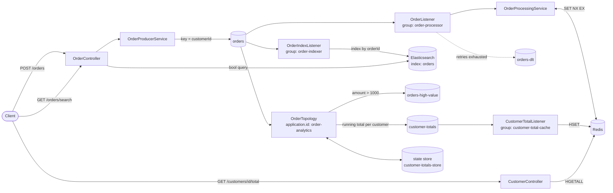

# kafka-streams-practice

Event-driven order service built with Spring Boot, Apache Kafka and Kafka Streams. It accepts orders over HTTP, publishes them as events, processes them with at-least-once delivery and derives real-time views from the event stream.

## Architecture



## Tech stack

| Technology | Version | Role |
|---|---|---|
| Java | 21 | Language and runtime |
| Spring Boot | 3.5 | Application framework, REST API, configuration |
| Apache Kafka | 3.9 (KRaft) | Event log and transport between components |
| Spring for Apache Kafka | 3.3 | Producer (`KafkaTemplate`), consumer (`@KafkaListener`), error handling |
| Kafka Streams | 3.9 | Stream processing: filtering and stateful aggregation |
| Redis | 7.4 | Deduplication of processed orders, read model for customer totals |
| Elasticsearch | 8.18 | Search index of orders |
| Kibana | 8.18 | UI to query and browse the index locally |
| JUnit 5, Mockito, AssertJ | — | Unit tests |
| Kafka Streams test utils | 3.9 | In-memory topology tests (`TopologyTestDriver`) |
| Docker Compose | — | Local Kafka, Redis and Elasticsearch |

## What Kafka is used for

Kafka is the backbone of the service. Every order becomes an immutable event in the `orders` topic, and each downstream concern reads that topic independently, at its own pace, without the HTTP layer knowing about it.

### Topics

| Topic | Partitions | Cleanup | Key | Value | Written by |
|---|---|---|---|---|---|
| `orders` | 3 | delete | `customerId` | `OrderEvent` (JSON) | `OrderProducerService` |
| `orders-dlt` | 3 | delete | `customerId` | Original record, plus failure headers | Consumer error handler |
| `orders-high-value` | 3 | delete | `customerId` | `OrderEvent` (JSON) | `OrderTopology` |
| `customer-totals` | 3 | compact | `customerId` | `CustomerTotal` (JSON) | `OrderTopology` |
| `customer-totals-dlt` | 3 | delete | `customerId` | Original record, plus failure headers | Consumer error handler |

Kafka Streams also manages one internal topic, `order-analytics-customer-totals-store-changelog`, which backs the state store.

### Producing

Orders are keyed by `customerId`, so all orders of a customer land in the same partition and are consumed in the order they were produced. The producer runs with `acks=all` and idempotence enabled.

### Consuming

`OrderListener` (consumer group `order-processor`) processes each order and commits the offset manually, only after processing succeeds. This gives at-least-once delivery: an order is never lost, but it can be delivered more than once.

Duplicates are filtered with Redis. Before processing, the service records the order id with an atomic `SET NX EX`; if the key already existed, the order is skipped. The mark is removed when processing fails, so retries are not mistaken for duplicates.

### Indexing

`OrderIndexListener` (consumer group `order-indexer`) reads `orders` independently and writes each order to the `orders` index in Elasticsearch. The order id is the document id, so an order delivered twice overwrites its own document instead of creating a second one.

Elasticsearch is a derived copy: it can be rebuilt at any time by replaying the topic. The index mapping is declared in `OrderDocument`: `customerId` is a `keyword` (exact match), `product` is `text` (full-text search) with a `keyword` sub-field.

### Error handling

The three listeners share the same error handling.

| Failure | Behaviour |
|---|---|
| `OrderProcessingException` (transient) | 3 attempts, 1 second apart, then published to `orders-dlt` |
| `InvalidOrderException` (permanent) | Published to `orders-dlt` without retrying |
| Record that cannot be deserialized | Published to `orders-dlt` as the original bytes |

Records in `orders-dlt` carry `kafka_dlt-*` headers with the exception and the original topic, partition and offset. After a record is sent to the dead letter topic its offset is committed, so one bad record never blocks a partition.

### Stream processing

`OrderTopology` (application id `order-analytics`) reads `orders` as an independent consumer group and maintains two derived streams:

- **High-value orders**: orders with an amount above 1000 are forwarded to `orders-high-value`.
- **Customer totals**: the order count and total amount per customer are aggregated in the `customer-totals-store` state store, and every update is published to `customer-totals`.

Records that cannot be deserialized are logged and skipped.

### Serving the totals

`CustomerTotalListener` (consumer group `customer-total-cache`) reads `customer-totals` and writes each update to Redis, one hash per customer (`customer-total:<customerId>`). `GET /customers/{customerId}/total` answers from Redis, so reads never touch Kafka.

Updates for a customer arrive in order because they share a partition, and each write overwrites the previous one, so replaying the topic leaves Redis in the same state. The read model is eventually consistent: a total is visible shortly after the order is accepted, not immediately.

## API

### `POST /orders`

```bash
curl -X POST localhost:8081/orders \
  -H 'Content-Type: application/json' \
  -d '{"customerId":"c1","product":"laptop","amount":1500}'
```

| Field | Type | Constraints |
|---|---|---|
| `customerId` | string | Required, not blank |
| `product` | string | Required, not blank |
| `amount` | number | Required, greater than 0 |

Returns `202 Accepted` with the generated event, or `400 Bad Request` when validation fails. Publishing is asynchronous: `202` means the event was handed to the producer, not that it was processed.

### `GET /orders/search`

Searches the Elasticsearch index. All parameters are optional and are combined with AND.

```bash
curl 'localhost:8081/orders/search?text=laptop&customerId=c1&minAmount=1000'
```

| Parameter | Description |
|---|---|
| `text` | Full-text search on `product`; tolerates small typos. Results are ranked by relevance |
| `customerId` | Exact match |
| `minAmount`, `maxAmount` | Inclusive amount range |
| `page` | Zero-based page number, default `0` |
| `size` | Page size between 1 and 100, default `10` |

```json
{
  "total": 1,
  "page": 0,
  "size": 10,
  "results": [
    {
      "orderId": "1109fa66-7a07-49c8-9152-acf70c1190de",
      "customerId": "c1",
      "product": "Laptop gamer 16GB",
      "amount": 1500.0,
      "createdAt": "2026-10-08T14:02:02.272Z",
      "score": 0.6877716
    }
  ]
}
```

Without `text`, results are sorted by `createdAt` descending and `score` is `null`. Invalid parameters return `400 Bad Request`. An order becomes searchable about a second after it is accepted.

### `GET /orders/stats/customers`

Returns the customers with the highest total spend, computed by Elasticsearch with a `terms` aggregation on `customerId` and `sum` and `avg` sub-aggregations on `amount`.

```bash
curl 'localhost:8081/orders/stats/customers?limit=3'
```

```json
[
  {"customerId":"c2","orderCount":2,"totalAmount":3225.50,"averageAmount":1612.75},
  {"customerId":"c1","orderCount":2,"totalAmount":2300.00,"averageAmount":1150.00}
]
```

`limit` is between 1 and 100 and defaults to `10`.

### `GET /customers/{customerId}/total`

```bash
curl localhost:8081/customers/c1/total
```

```json
{"customerId":"c1","orderCount":2,"totalAmount":300.50}
```

Returns `404 Not Found` when no order has been aggregated for the customer yet.

## Running locally

Requirements: JDK 21, Maven, Docker.

```bash
docker compose up -d      # Kafka :9092, Redis :6379, Elasticsearch :9200, Kibana :5601
mvn spring-boot:run       # API on localhost:8081
```

Topics and the Elasticsearch index are created on startup, so the containers must be up before the application starts.

### Inspecting the system

```bash
# read a topic
docker exec -it kafka-lab /opt/kafka/bin/kafka-console-consumer.sh \
  --bootstrap-server localhost:9092 --topic customer-totals --from-beginning \
  --property print.key=true

# consumer group offsets and lag
docker exec kafka-lab /opt/kafka/bin/kafka-consumer-groups.sh \
  --bootstrap-server localhost:9092 --describe --group order-processor

# processed order ids
docker exec redis-lab redis-cli --scan --pattern 'processed-order:*'

# total stored for a customer
docker exec redis-lab redis-cli HGETALL customer-total:c1

# indexed orders
curl 'localhost:9200/orders/_search?pretty'
```

Kibana is available at http://localhost:5601. Use **Dev Tools** to run queries against the index, or create a data view for `orders` to browse documents in **Discover**.

## Testing

```bash
mvn test
```

Tests need no running infrastructure: the topology runs in memory with `TopologyTestDriver`, and the service tests mock the repositories.

## Project structure

```
src/main/java/com/mricotta/kafkalab
├── config        Topics, consumer error handling, Kafka Streams setup
├── controller    REST endpoints
├── dto           HTTP request and response payloads
├── entity        Elasticsearch documents
├── event         Payloads written to Kafka topics
├── exception     Domain exceptions
├── listener      Kafka consumers
├── mapper        DTO to event mapping
├── repository    Redis and Elasticsearch access
├── service       Business logic
└── streams       Kafka Streams topology
```

## Configuration

Settings live in `src/main/resources/application.yml`.

| Property | Default | Description |
|---|---|---|
| `server.port` | `8081` | HTTP port |
| `spring.kafka.bootstrap-servers` | `localhost:9092` | Kafka brokers |
| `spring.kafka.consumer.group-id` | `order-processor` | Consumer group of `OrderListener` |
| `spring.kafka.streams.application-id` | `order-analytics` | Kafka Streams application id |
| `spring.data.redis.host` / `port` | `localhost` / `6379` | Redis connection |
| `spring.elasticsearch.uris` | `http://localhost:9200` | Elasticsearch nodes |

## Known limitations

- The local broker is a single node, so topics use a replication factor of 1 and offer no fault tolerance.
- Elasticsearch runs as a single node with security disabled, for local use only.
- Deduplication only covers `OrderListener`. The Kafka Streams topology counts an order twice if the same event is written to `orders` twice.
- Order processing is simulated: an order with product `fail` or `invalid` triggers the transient or permanent failure path.
